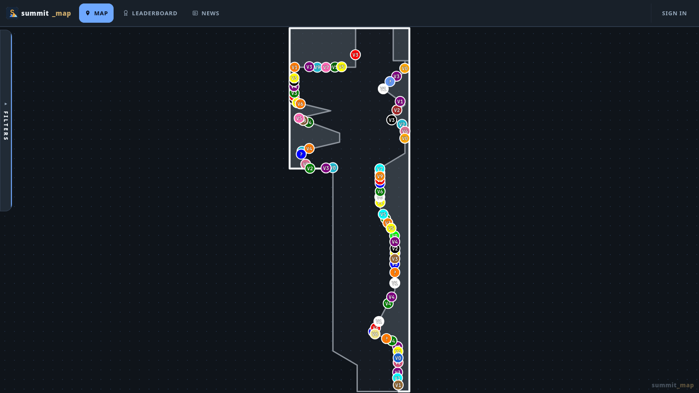
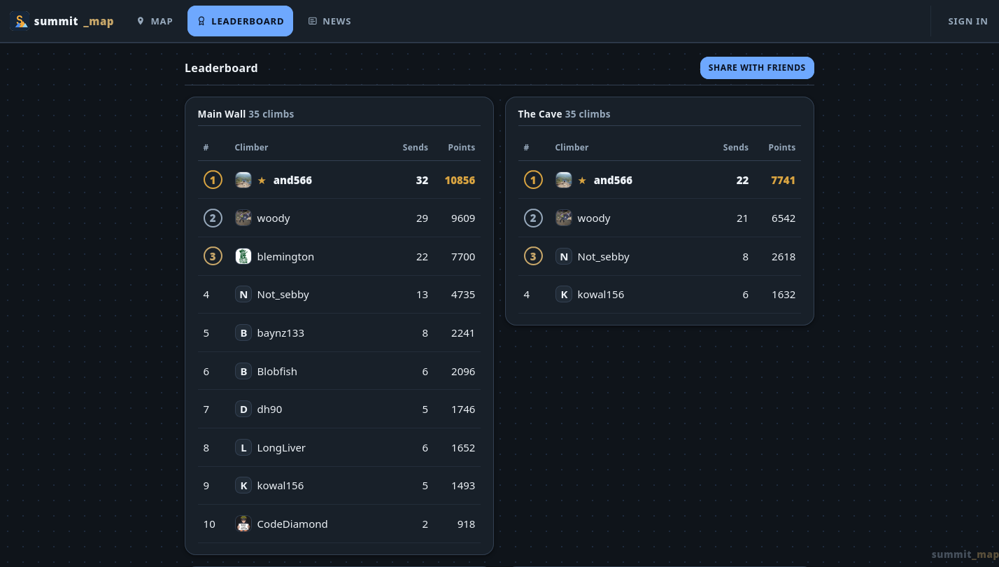
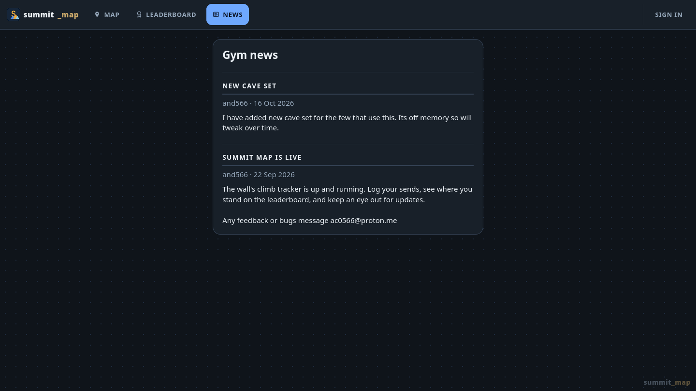

<p align="center">
  
</p>

<h1 align="center">Summit Map</h1>

<p align="center">
  Every problem on the wall, mapped, logged and ranked.<br>
  A small web app for a climbing wall and the people who climb on it.
</p>

<p align="center">
  <a href="https://summit.andw.net"><b>summit.andw.net</b></a>
</p>

<p align="center">
  
  
  
  
</p>

<p align="center">
  
</p>

## What it does

The wall has two boards — **Main Wall** and **The Cave** — and a full
circuit of problems on each. Summit Map keeps a live picture of that,
and of everyone climbing it.

- **The wall, mapped.** Every climb sits on an interactive outline of
  the board, exactly where it is on the wall. Filter by sent, unsent or
  grade, and read the tape colour at a glance.
- **Log your sends.** Tick a climb off and see your points, then compare
  with the rest of the wall on the per-board leaderboard.
- **Grades you can argue with.** Community grade votes, star ratings and
  comments on every problem.
- **Setters' tools.** Build a set as a quiet draft, place and edit climbs
  on the board, activate the set when it goes up, review flags and void
  ascents — all without touching Django admin.
- **Your own stats.** Sends, points and best grade over 6 months,
  12 months or all time, per wall.
- **Installable app.** A real PWA — home-screen install with the
  "Install app" button on your profile, plus a QR code and share link on
  the leaderboard.
- **Seven themes**, mobile first, and no CDN or frontend build step:
  plain templates, CSS custom properties and vanilla JS.

## Screenshots

<table>
  <tr>
    <td width="50%"></td>
    <td width="50%"></td>
  </tr>
</table>

<p align="center"><sub>Leaderboard: points, sends and places for each wall &nbsp;·&nbsp; Gym news</sub></p>

## Stack

| Layer | Choice |
| --- | --- |
| Backend | Django 6.1 on Python 3.12 |
| Database | SQLite (one file, backed up with the volume) |
| Static files | WhiteNoise, hashed and compressed at build time |
| Frontend | Django templates, CSS custom properties, vanilla JS — no framework, no bundler |
| Server | Gunicorn in a single non-root container |
| Ingress | Cloudflare Tunnel — no ports open on the LAN or the internet |

## Run it locally

Python 3.12 or newer is assumed.

```sh
git clone https://github.com/And5666/Climbing-Web-app.git
cd Climbing-Web-app

python -m venv .venv
source .venv/bin/activate        # Windows: .venv\Scripts\activate
pip install -r requirements.txt

python manage.py migrate
python manage.py createsuperuser
python manage.py runserver
```

Then open <http://127.0.0.1:8000>. Debug mode is on by default
(`DJANGO_DEBUG=True`), so static files and tracebacks just work.

Run the test suite — 200-plus tests across climbs and accounts:

```sh
python manage.py test
```

`requirements-dev.txt` adds WeasyPrint and the other local-only extras;
the container only needs `requirements.txt`.

## Deploying

The whole app is one container. See [DEPLOY.md](DEPLOY.md) for the full
walkthrough: generate a secret key, `docker compose up -d`, point a
Cloudflare Tunnel at `127.0.0.1:8000`, and migrations run on boot.
The database and uploaded avatars live in the `summit-data` volume.

## Project layout

```
summit_map_project/   settings, root URL configuration
climbs/               the wall: map, climbs, sets, leaderboard, news,
                      manifest, service worker, setters' admin tools
accounts/             profiles, personal stats, install-prompt endpoints
docs/screenshots/     the images in this README
Dockerfile            python:3.12-slim, non-root, collectstatic baked in
docker-compose.yml    one web service plus the data volume
DEPLOY.md             deployment notes
```

## How the wall works

- Grades run **V0–V10**; each tape colour is a circuit covering a band of
  grades (white easiest, orange hardest), with **project** and
  **mystery** as special cases.
- A **mystery** climb can be any grade, and its true grade stays hidden
  until the setters reveal it the following week.
- Only one set is live per wall. New sets start as drafts, so the wall
  can be stripped and rebuilt without disturbing the live map.
- Points come from the climb's official grade, with a small bonus for
  fewer tries, so the leaderboard rewards difficulty, volume and flashes
  together. Community grade votes never change the score.
